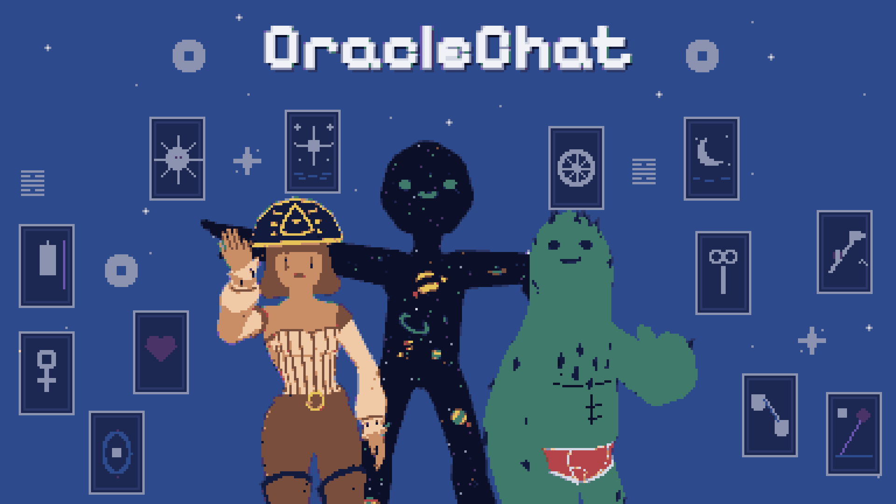
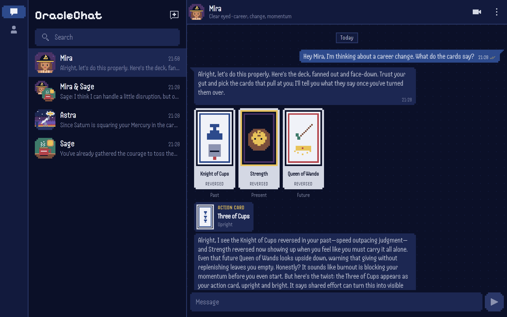
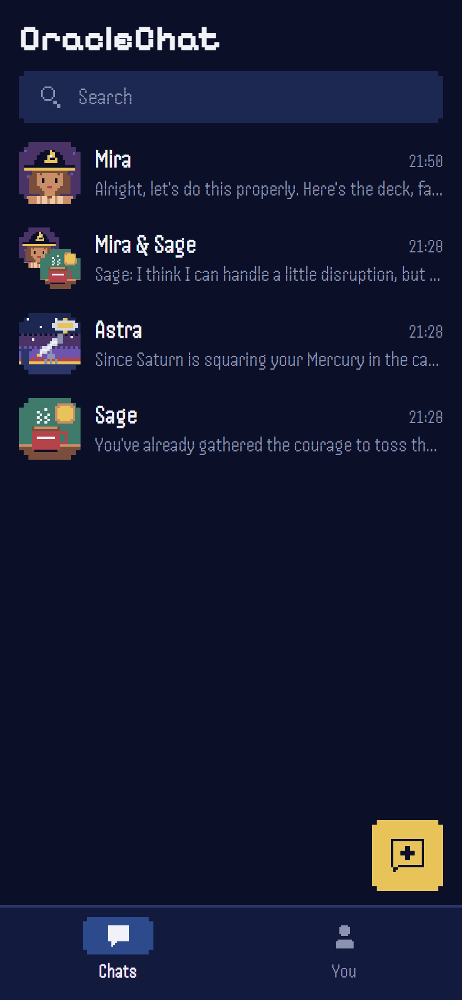
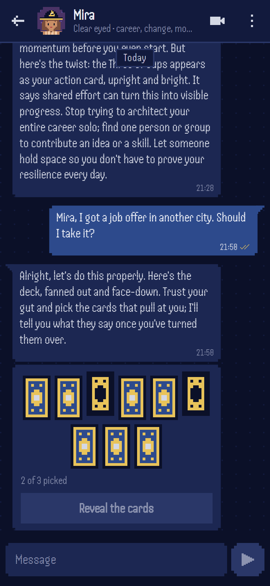
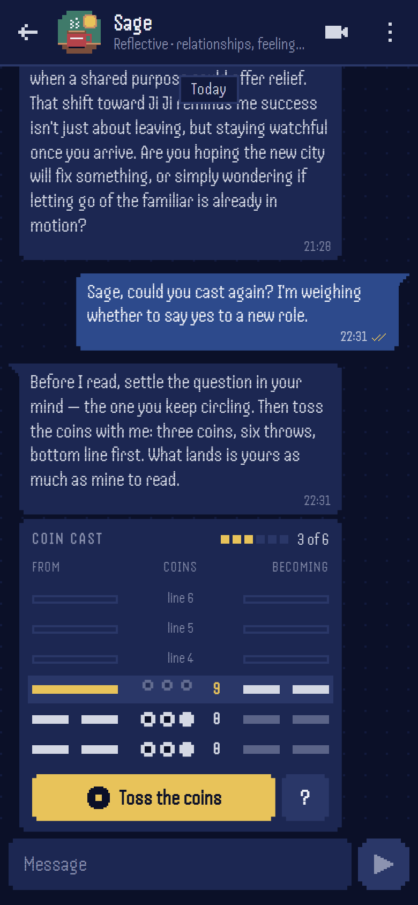
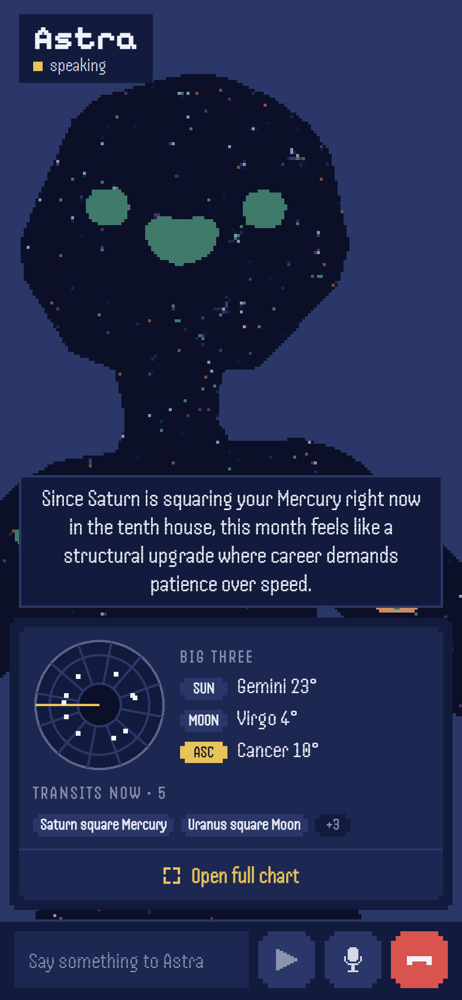
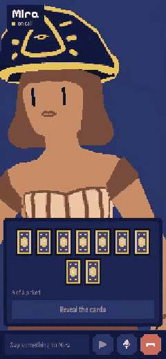
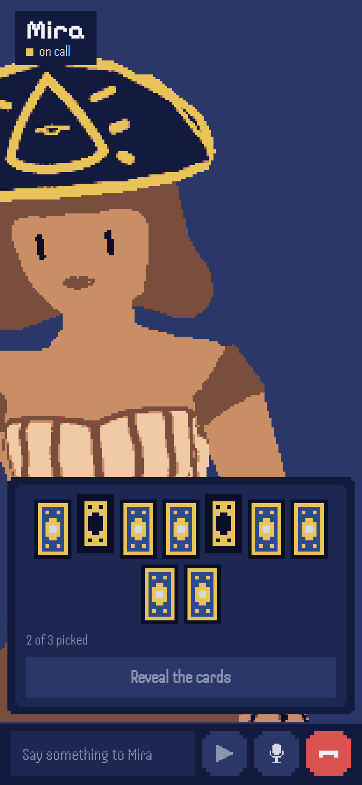
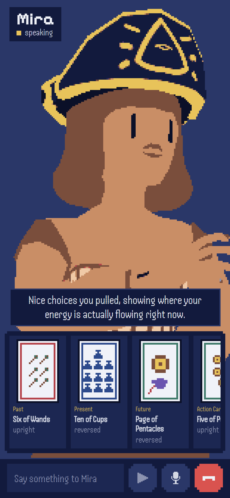
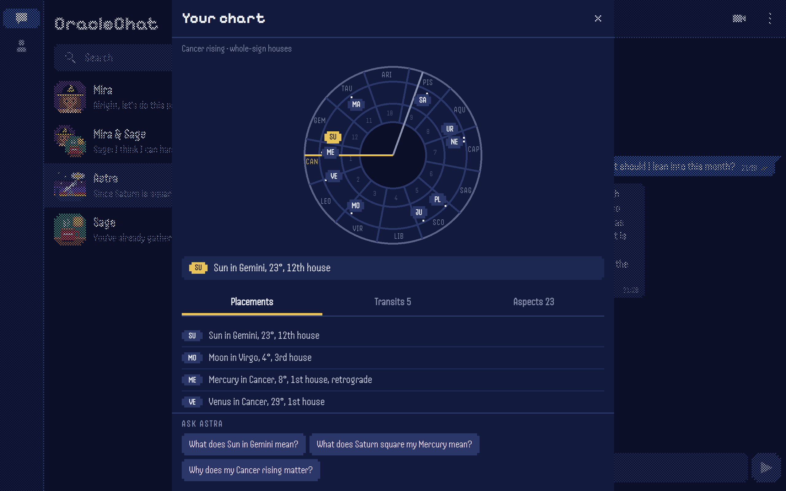

# OracleChat

<p align="center">
  <a href="#repository-map">Repository map</a> · <a href="#development-workflow">Development workflow</a> · <a href="#installation-and-setup">Installation and Setup</a><br>
  <a href="#models">Models</a> · <a href="#running">Running</a> · <a href="#using-oraclechat">Using OracleChat</a> · <a href="#stack">Stack</a> · <a href="#credits">Credits</a> · <a href="#license">License</a>
</p>



OracleChat is a local-first chat with four guides: Mira (tarot), Sage (I Ching), Astra (astrology) and Milo (workplace reflection). It is a 4-bit pixel chat app laid out like WhatsApp: one chat per guide or pair, interactive readings and short workplace prompts in the thread, and video calls with a pixel-filtered 3D guide who speaks in their own voice. The current requirements live in [`openspec/specs/`](openspec/specs/); [`docs/prd.md`](docs/prd.md) records the agreed product and stack direction.



<table>
  <tr>
    <td align="center"><br><sub>One chat per teller</sub></td>
    <td align="center"><br><sub>Mira's card fan</sub></td>
    <td align="center"><br><sub>Sage's coin toss</sub></td>
    <td align="center"><br><sub>A call with Astra</sub></td>
  </tr>
</table>

## Repository map

- `openspec/specs/` — product requirements and acceptance scenarios
- `openspec/changes/` — scoped proposals, designs, and implementation tasks
- `backend/agent/src/` — Agents SDK local runtime, chat, orchestration, tarot, memory, and telemetry
- `frontend/app/` — OracleChat: the chat list, chats with reading cards, video calls, and the You tab (memory, birth details)
- `services/tts/` — speech sidecar for video calls (OmniVoice voices, Whisper transcription)
- `docs/adr/` — accepted architecture decisions and review process
- `docs/milestones.md` — dependency-ordered delivery milestones

## Development workflow

Install dependencies with `pnpm install`. Before changing behavior, update OpenSpec, review applicable ADRs, and use the test-first workflow in [`AGENTS.md`](AGENTS.md).

```sh
pnpm test
pnpm lint
pnpm build
pnpm adr:check
```

## Installation and Setup

Install dependencies:

```sh
pnpm install
```

On Windows 11 with WSL2, the existing Ubuntu distro can run PostgreSQL with pgvector without Docker Desktop. From PowerShell in the repository root, run this once to install PostgreSQL/pgvector in WSL if needed and provision OracleChat's database:

```powershell
wsl --distribution Ubuntu-24.04 --user root --exec bash scripts/setup-local-postgres-wsl.sh
```

WSL starts in the current Windows folder, so the script path is relative to the repository wherever it is cloned. The setup script creates the local `agent` role and `agent_memory` database and enables pgvector.

Install [Ollama](https://ollama.com/) separately and pull the models listed under [Models](#models). Copy `.env.example` to `.env` and set `OLLAMA_MODEL` to the chat model. Set `DATABASE_URL` to the local database shown in the example.

### Models

Everything runs on your own GPU. Sizes are the downloads on disk.

| Model | Used for | Size | Needed |
| --- | --- | --- | --- |
| Qwen 3.5 9B (`qwen3.5:9b`, Ollama) | Teller replies, routing and memory extraction | 6.6 GB | Always |
| `nomic-embed-text` (Ollama) | Memory recall | 274 MB | Always |
| [OmniVoice](https://github.com/k2-fsa/OmniVoice) | Each teller's voice in video calls | 3.0 GB | Calls only |
| Whisper large-v3-turbo | Speech recognition when you talk in a call | 1.5 GB | Calls only, to talk instead of type |

```sh
ollama pull qwen3.5:9b
ollama pull nomic-embed-text
```

`OLLAMA_MODEL` names the chat model and `OLLAMA_EMBED_MODEL` the embedding model (`nomic-embed-text` by default). The speech models are folders that `OMNIVOICE_MODEL_PATH` and `WHISPER_MODEL_PATH` in `.env` point to; their setup is in [`docs/operations.md`](docs/operations.md). All four together use about 15.6 GB of VRAM, so a 16 GB card is enough. Without the speech models, chat still works and calls show subtitles only. With [hosted replies](docs/operations.md) turned on, teller replies come from a hosted model instead, but the local models are still needed for routing, memory and embeddings.

## Running

Four services make up a full local stack: PostgreSQL, the local model, the agent backend, and the frontend — plus an optional speech sidecar for video calls. Start them in this order; each step says what it does and where it listens.

### 1. Start PostgreSQL

OracleChat stores conversations and memories in local PostgreSQL with pgvector. Use **one** of the two options below, never both. Each runs its own separate database on port 5432, so data saved in one is not in the other. If you ran the WSL setup above, use the WSL option.

With Docker:

```sh
docker compose up -d postgres
```

With WSL2, start the cluster from a separate PowerShell terminal and keep that terminal open — WSL stops when its command exits, which makes PostgreSQL unreachable from Windows:

```powershell
wsl --distribution Ubuntu-24.04 --user root --exec bash -lc "(pg_ctlcluster 16 main status >/dev/null 2>&1 || pg_ctlcluster 16 main start) && exec sleep infinity"
```

### 2. Have Ollama running with a local model

The backend reaches Ollama at its local endpoint for inference; `OLLAMA_MODEL` in `.env` names the model. Start Ollama and pull the models if you have not (see [Models](#models)). The model loads into VRAM on first use and stays resident; if VRAM is tight, `ollama stop <model>` evicts it and it reloads on the next message (about 10 s for the first reply).

### 3. (Calls only) start the speech sidecar

```sh
pnpm tts
```

Runs the Python sidecar (`services/tts`) on `http://127.0.0.1:4100` (`GET /health`): OmniVoice voice cloning and Whisper transcription, both on the GPU (about 6.6 GB VRAM next to the chat model). Skip it if you don't need video calls — calls still open and show subtitles marked "Voice offline". One-time setup (venv, voices, 3D models) is in [`docs/operations.md`](docs/operations.md).

### 4. Build and start the agent backend

```sh
pnpm --filter @oracle/agent build
pnpm --filter @oracle/agent start
```

The build compiles TypeScript and copies teller YAML definitions into `dist`. The start command runs `dist/server.js` with the root `.env` and listens on `http://127.0.0.1:4000` (`GET /health`). Teller definitions load from disk when the process starts, so restart the backend after changing them. To verify real local inference, run `pnpm --filter @oracle/agent smoke:model` after building and setting `OLLAMA_MODEL`; local mode does not fall back to hosted inference.

### 5. Start the frontend

Pick one mode — never mix them. Both listen on `http://localhost:3000`.

While editing code, run the dev server. It uses `next dev` and recompiles from source as files change:

```sh
pnpm --filter @oracle/frontend dev
```

For day-to-day use, build once and serve the production build. It uses `next start` and is faster and more stable, but it serves the last build, not your latest edits:

```sh
pnpm --filter @oracle/frontend build
pnpm --filter @oracle/frontend start
```

The frontend proxies to the local agent through same-origin API routes; set `ORACLE_AGENT_URL` only if the backend uses another address.

### Optional: view traces in Langfuse

The backend sends OpenTelemetry traces of each turn (model name and token counts per model call) to a local Langfuse when its keys are set ([ADR-0004](docs/adr/0004-opentelemetry-first-observability.md)). It needs Docker Desktop:

```sh
docker compose up -d langfuse
```

This starts Langfuse on `http://localhost:3002` with its own database, ClickHouse, Redis and MinIO containers; it does not start OracleChat's PostgreSQL. The first start pulls several images and takes a few minutes. Set the `LANGFUSE_*` values from `.env.example` in `.env`, restart the backend, then log in with `LANGFUSE_USER_EMAIL` and `LANGFUSE_USER_PASSWORD`. Without the keys, traces only go to the backend console.

By default traces carry no content, so Langfuse shows each span's Input and Output as "undefined". To see prompts and replies while debugging, set `TRACE_CONTENT=1` in `.env` and restart the backend. Every trace destination then receives them, LangSmith included, so leave `LANGSMITH_API_KEY` empty to keep them on your PC. Details are in [`docs/operations.md`](docs/operations.md).

With hosted replies on OpenAI, you can also send those replies to the OpenAI Traces dashboard (platform.openai.com → Logs → Agents SDK) by setting `OPENAI_TRACES=1` ([ADR-0022](docs/adr/0022-opt-in-openai-traces-for-hosted-replies.md)). Only hosted teller replies are sent, one `Oracle teller reply` trace each, using `HOSTED_API_KEY`. Routing, memory, guardrail checks and local replies never go there, and prompts and replies are included only while `TRACE_CONTENT=1` is on. The backend refuses to start if the switch is on without hosted replies on `api.openai.com`.

### Optional: compare the local and hosted models

With Ollama running and hosted replies configured, this runs 24 test prompts through the real chat service, once with local teller replies and once with hosted ones:

```sh
pnpm --filter @oracle/agent eval:models
```

The two runs share the same local routing. Fans and coin tosses are played the way a user would. Each reply is checked for:
- naming the app-owned draw;
- inventing cards, hexagrams or chart placements;
- staying in character;
- in pair chats, whether the right teller gave the reading.

Results and full transcripts are written to `backend/agent/eval/results/` (git-ignored). The prompts are in `backend/agent/eval/cases.ts`; set `EVAL_CASES=mira-one-card,pair-unnamed` to run only some. The run calls the hosted model, so it is billed, and it is not part of `pnpm test`.

### Never build while the production server is running

`pnpm --filter @oracle/frontend build` writes into the same `.next` folder a running `next start` server is serving from. The server keeps its old in-memory route manifests while the compiled chunks on disk are replaced, and the result is a silently corrupted hybrid: pages load but misbehave in ways that look like code bugs (on 2026-11-20 it produced blank 3D call models with a flood of WebGL errors — with nothing wrong in the code). To rebuild safely:

1. Stop the running `next start` process (it owns port 3000).
2. Delete `frontend/app/.next` if things still look wrong after rebuilding.
3. Run `pnpm --filter @oracle/frontend build`.
4. Start `pnpm --filter @oracle/frontend start` again.

If a page behaves like a stale or broken build, suspect this first: check which process owns port 3000 (`netstat -ano | findstr :3000`) and restart it cleanly before debugging code.

The tarot catalog includes original upright/reversed interpretations and original pixel-art card faces. Provenance is recorded in [`docs/tarot/content-provenance.md`](docs/tarot/content-provenance.md).

## Using OracleChat

- **Chats:** the list has one row per teller, or pair of tellers, named like a WhatsApp contact, with the last message and its time. The new-chat button reopens an existing chat rather than starting another. On a phone the list and the open chat take turns; on a desktop they sit side by side.
- **Readings and reflections:** ask Mira for tarot, Sage for an I Ching casting, or Astra for a birth chart. Milo offers one of seven brief workplace prompts when it fits the conversation: work-style preferences, team climate, meetings, culture signals, tradeoffs, strengths or role direction. These prompts are optional reflection, not a formal personality assessment or company-fit verdict.
- **Video calls:** the camera button in a one-to-one chat opens a call. Type or talk in the bar along the bottom; readings work in calls too and appear just above the bar while the teller speaks. Milo's prompts continue as ordinary conversation.
- **You:** memory, sharing with a hosted model, birth details and clearing chat history.

<table>
  <tr>
    <td align="center"><a href="docs/images/mira-video-call.mp4"></a><br><sub><a href="docs/images/mira-video-call.mp4">Watch the full call with sound (1:26)</a></sub></td>
    <td align="center"><br><sub>Picking cards in a call</sub></td>
    <td align="center"><br><sub>Mira speaks the reading</sub></td>
  </tr>
</table>



The design rules (palette, pixel fonts, stepped shapes, icons) are in [ADR-0019](docs/adr/0019-oraclechat-pixel-design-system.md) and `openspec/specs/interface-design/`.

## Stack

Everything runs on one Windows 11 PC (developed on an RTX 5080 with 16 GB of VRAM); nothing needs a hosted API key ([ADR-0002](docs/adr/0002-local-first-model-execution.md), [ADR-0010](docs/adr/0010-production-profile-owner-pc.md)).

| Layer | What it uses |
| --- | --- |
| Frontend | TypeScript, React 18, Next.js 14 (App Router), react-markdown. The pixel interface is hand-written CSS and SVG ([ADR-0019](docs/adr/0019-oraclechat-pixel-design-system.md)). |
| Video calls | three.js with `@pixiv/three-vrm` and `@pixiv/three-vrm-animation` for the VRM tellers, a palette-snapping pixel filter, and wLipSync for vowel lip sync. |
| Backend | TypeScript, Express 5, the OpenAI Agents SDK for TypeScript (run against the local model), Zod and YAML teller definitions. |
| Models | [Ollama](https://ollama.com/) running Qwen 3.5 9B (`qwen3.5:9b`) for the tellers and `nomic-embed-text` for memory recall. Teller replies can optionally come from a hosted OpenAI-compatible model ([ADR-0014](docs/adr/0014-hosted-teller-replies.md)). |
| Speech | A Python sidecar (FastAPI, PyTorch) with [OmniVoice](https://github.com/k2-fsa/OmniVoice) for each teller's cloned voice and Whisper large-v3-turbo for speech recognition, both on the GPU. |
| Data | PostgreSQL 16 with pgvector, in WSL2. |
| Readings | App-owned tarot draws, I Ching castings, and natal charts computed with astronomy-engine, from bundled original catalogs; birth places from an offline GeoNames extract. |
| Observability | OpenTelemetry traces, optionally exported to a local Langfuse (Docker) or LangSmith, with no message content unless `TRACE_CONTENT` is on ([ADR-0004](docs/adr/0004-opentelemetry-first-observability.md)). Hosted OpenAI replies can also go to the OpenAI Traces dashboard ([ADR-0022](docs/adr/0022-opt-in-openai-traces-for-hosted-replies.md)). |
| Workflow | pnpm workspaces, Vitest, ESLint, OpenSpec specs and ADRs, and an on-demand local-vs-hosted teller eval (see [`AGENTS.md`](AGENTS.md)). |

## Credits

**3D tellers.** The low-poly avatars are from [100Avatars](https://github.com/PolygonalMind/100Avatars) by Polygonal Mind under [CC BY 4.0](https://creativecommons.org/licenses/by/4.0/): Rose (#57) is Mira, Cactus Boy (#9) is Sage, Cosmic Person (#129) is Astra, and Cool Polygonal Mind (#200) is Milo. Milo's VRM is included in this repository; the other teller models remain local setup assets. See [`docs/asset-attribution.md`](docs/asset-attribution.md) for attribution and [`docs/operations.md`](docs/operations.md) for setup.

**Animations.** The idle and talking motions are [Mixamo](https://www.mixamo.com/) clips (Breathing Idle, Talking, Talking 2 and Talking 3) converted to VRM Animation. Mixamo's terms allow use in projects but not redistribution, so the clips stay out of git.

**Models.**
- Qwen 3.5 9B by the Qwen team at Alibaba Cloud (Apache 2.0), via Ollama.
- `nomic-embed-text` by Nomic AI (Apache 2.0).
- [OmniVoice](https://github.com/k2-fsa/OmniVoice) by the k2-fsa project (Apache 2.0) for the tellers' voices; each voice is generated from a text description with its `make_voice.py`, not cloned from a real person.
- Milo's OmniVoice reference clip and transcript are included at `services/tts/voices/milo.wav` and `milo.txt`; other teller voice clips remain local setup assets.
- Whisper large-v3-turbo by OpenAI (MIT).

**Fonts.** [Handjet](https://github.com/rosettatype/Handjet) (Rosetta Type) for body text and [Pixelify Sans](https://github.com/eifetx/Pixelify-Sans) for titles, both under the SIL Open Font License 1.1; the licence files ship beside the fonts in `frontend/app/src/app/fonts/`.

**Data and code.**
- Birth places: [GeoNames](https://www.geonames.org/) `cities15000`, CC BY 4.0 (see `backend/agent/data/places.provenance.md`).
- Lip sync: [wLipSync](https://github.com/mrxz/wlipsync) and its sample uLipSync profile, MIT (see `frontend/app/public/lipsync/README.md`).
- Libraries: three.js, `@pixiv/three-vrm`, astronomy-engine, the OpenAI Agents SDK, Next.js, React and Express, all MIT.

**Original work.** The tarot and I Ching interpretations, the pixel tarot cards, the teller profile pictures and the interface are original to OracleChat (see [`docs/tarot/content-provenance.md`](docs/tarot/content-provenance.md)). Tarot card names and suits follow traditional usage.

## License

Copyright © 2026 Joe Chung. All rights reserved. The code, character definitions, written content and artwork are shared for viewing and evaluation only; see [`LICENSE`](LICENSE). Third-party components keep their own licences, listed under [Credits](#credits).
