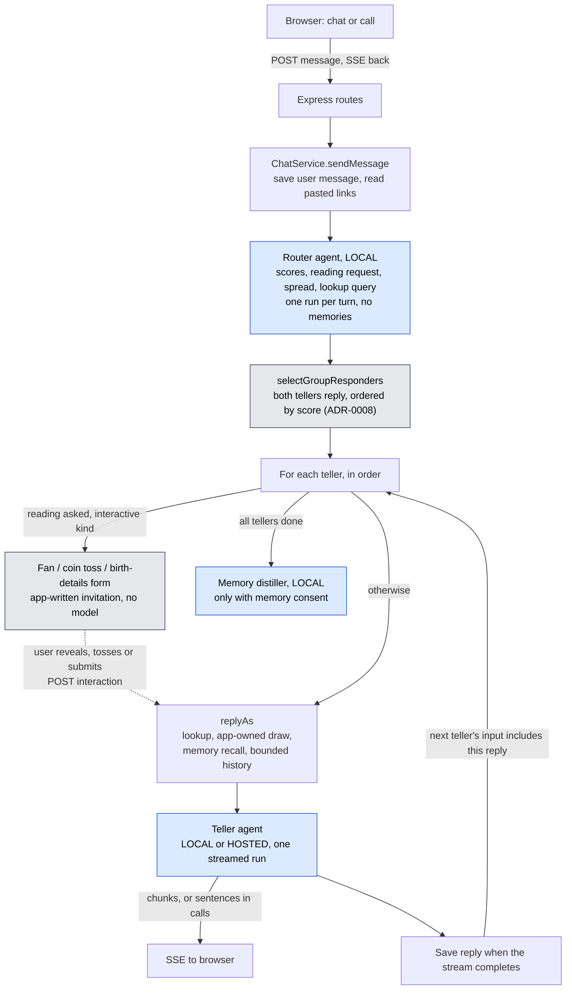
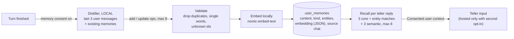

# OracleChat architecture

This document explains how a chat turn works: routing, the tellers, conversation history and user memory. It describes the system and links to the sources of truth. Requirements live in [`openspec/specs/`](../openspec/specs/), and decisions live in [`docs/adr/`](adr/README.md). If this file disagrees with them, they win. Update this file when a change touches routing, history or memory.

## The pieces

| Piece | Where | Runs on |
|---|---|---|
| Chat UI (Next.js) | `frontend/app/` | Browser |
| API and SSE stream (Express) | `backend/agent/src/server/app.ts` | PC |
| Turn sequencing | `backend/agent/src/chat/service.ts` (`ChatService`) | PC |
| Router agent | `backend/agent/src/orchestration/router.ts` | Local model |
| Teller agents | `ChatService.replyAs` + `backend/agent/src/agent/runtime.ts` | Local model, or hosted if configured ([ADR-0014](adr/0014-hosted-teller-replies.md)) |
| Memory distiller agent | `backend/agent/src/memory/extractor.ts` | Local model |
| Embeddings | `backend/agent/src/memory/embedder.ts` | Local `nomic-embed-text` |
| Readings (cards, castings, charts) | `backend/agent/src/{tarot,iching,astrology}/` | App code, never a model ([ADR-0013](adr/0013-one-discipline-per-teller.md)) |
| Storage | PostgreSQL: `chat/store.ts`, `memory/store.ts`, `astrology/profile-store.ts` | PC |
| Speech in calls | `services/tts/`, browser speech recognition | PC ([ADR-0015](adr/0015-local-voice-calls.md), [ADR-0016](adr/0016-local-speech-recognition.md)) |

**There are no agent handoffs.** Every model call is a single, separate Agents SDK run (`Runner.run` on a single `Agent`). `ChatService` decides what runs, in what order, and with what input ([ADR-0003](adr/0003-agents-sdk-orchestration.md)). When a second teller "hears" the first, it's because the app put the first reply into the second teller's input.

## A turn, end to end

Opt-in OpenAI guardrails are proposed in [`add-openai-guardrails`](../openspec/changes/add-openai-guardrails/design.md). They would add a check on your message before routing and a per-sentence check between the teller agent and the browser.

## Routing

Spec: [orchestration](../openspec/specs/orchestration/spec.md), [chat › Readings are asked for](../openspec/specs/chat/spec.md). ADRs: [0008](adr/0008-group-tellers-always-respond.md), [0012](adr/0012-teller-led-readings-and-lookups.md), [0013](adr/0013-one-discipline-per-teller.md).

- **One local call per turn, in one-to-one and group chats alike.** It runs at temperature 0 with thinking off, and its output must match a JSON schema.
- **Input:**
  - each teller's id, name, discipline and activation profile (its topics, emotional tones and situations);
  - the tellers' replies from the previous turn (each cut to 600 characters), so "yes, go ahead" can accept an offered reading;
  - the message.

  No memories, no older history.
- **Output, per teller:**
  - `score` (0–1) and `matchedCategories`;
  - `reading`: `named`, `unnamed` or `none`;
  - `spread` (tarot only);
  - an optional web `query` (at most 200 characters).
- **What the app does with it:**
  - Both tellers always reply. The score only sets the order, and ties go to whoever spoke least recently.
  - A teller reads if its route is `named`, or if it's `unnamed` and that teller replies first.
  - A non-empty query runs a Brave lookup for that teller.
- **If routing fails:** both tellers reply in least-recently-spoken order, with no reading and no lookup. Routing never fails a turn.

## Conversation history

Spec: [chat › Local conversation history, Bounded teller history, Messages are saved when complete](../openspec/specs/chat/spec.md).

- **Storage:** PostgreSQL tables `conversations`, `conversation_tellers` and `messages`. Message rows carry JSON columns for the reading, signature card, search results, links and interaction state.
- **No sessions.** The conversation id is the only session. It's also `langfuse.session.id` in traces. Agents keep no state between runs.
- **Saving:**
  - The user message is saved before routing.
  - A teller reply is saved once its stream completes. A reply interrupted by an error or a restart is not saved, and the conversation continues from the last saved message.
  - Interactive readings save their state on the message. Updates only apply if the state hasn't changed since it was read, so a repeated reveal fails cleanly.

  There is no mid-reply checkpoint or resume.
- **Context limit:** for every reply, history is rebuilt from stored messages and cut to the newest lines that fit `HISTORY_TOKEN_BUDGET` (default 8,000 estimated tokens, about 4 characters each). Older lines are replaced by `(Earlier conversation omitted.)`. They are dropped, not summarised. Instructions, memories and the reading are added on top and never cut.

## User memory

Spec: [memory](../openspec/specs/memory/spec.md). ADRs: [0009](adr/0009-relevance-filtered-memory-recall.md) (its ranker clause is superseded by 0012), [0014](adr/0014-hosted-teller-replies.md).

- **Consent first.** Nothing is extracted, stored or recalled without memory consent. Turning consent off deletes every memory and resets hosted sharing.
- **Writing:** after the tellers reply, the local distiller sees the **last three user messages** (never teller replies) and the existing memories. It returns `add` or `update` operations and never deletes. Facts are short phrases labelled:
  - `core`: name, pronouns, closest relationships;
  - `detail`: everything else.

  Each fact is tagged with lower-case entities, plus a teller's id when it's about you and that teller. If extraction fails, the turn still succeeds.
- **Storage:** one row per fact in `user_memories`. The embedding is stored as JSON and compared in TypeScript; pgvector isn't used at this scale (ADR-0009).
- **Recall,** per teller reply, at most 8 memories in this order:
  1. up to 3 `core` memories;
  2. entity matches (a name in your message, or the replying teller's id);
  3. up to 3 semantic matches with similarity at least 0.45 and at least 0.09 above the average across all memories.

  The router gets no memories.
- **Hosted replies** receive memories only when the second opt-in, *Share saved details with the hosted model*, is on.
- **Lifecycle:**
  - Deleting a conversation deletes the memories it produced.
  - "Clear all chats" keeps memories and unlinks them from their source.
  - You can view, edit, pin (make `core`) and delete memories in the You panel.

## What leaves the PC

| Data | Default | With hosted replies (ADR-0014) |
|---|---|---|
| Router, distiller and embedding calls | Local | Local |
| Teller instructions, bounded history, reading, lookup results | Local | Hosted provider |
| Saved memories, exact chart degrees | Local | Hosted only with the second opt-in |
| Web lookup query | Brave, if a key is set | Same |
| Traces | Local OTel, optional Langfuse/LangSmith export without content ([ADR-0004](adr/0004-opentelemetry-first-observability.md)) | Same |
