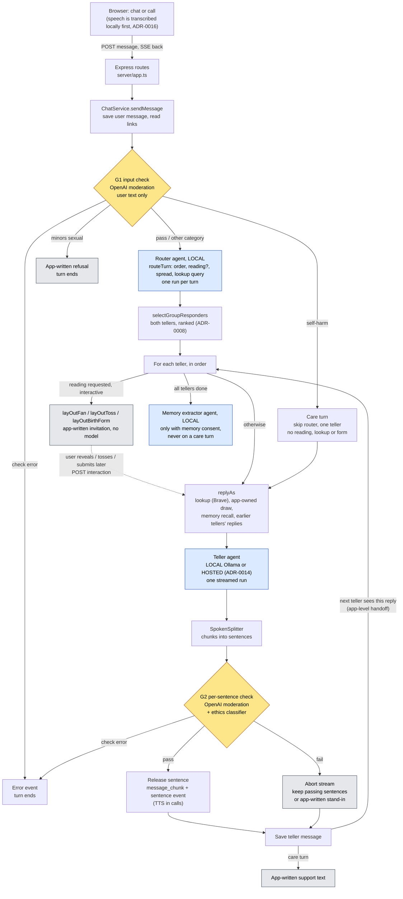
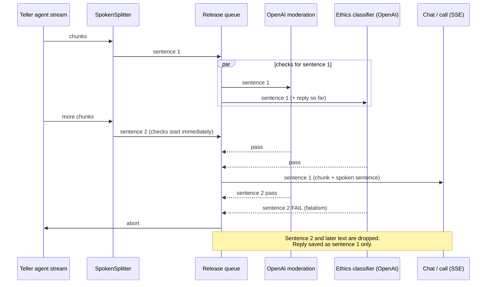

# Design

## Context

A chat turn enters at `ChatService.sendMessage` (`backend/agent/src/chat/service.ts`). From there, `runTurn`:

1. saves the user message and reads any links;
2. calls the local router (`orchestration/router.ts`, `routeTurn`) once;
3. orders the tellers with `selectGroupResponders`;
4. for each teller in turn, either lays out an app-written interactive reading (`layOutFan`, `layOutToss`, `layOutBirthForm`) or calls `replyAs`;
5. finally runs memory extraction (skipped for care turns in guarded mode).

`replyAs` does the lookup, draws the reading, recalls memories, builds the input and streams the teller agent through `options.stream`. That stream is local (`agent/runtime.ts`, `streamLocalAgent`) or hosted (`agent/hosted.ts`), as `server.ts` chose at startup. Call turns already split the stream into sentences with `SpokenSplitter` (`chat/spoken.ts`).

**There are no agent handoffs.** Each model call is a single, separate Agents SDK run (`Runner.run` on a single `Agent`), and the application code does all the sequencing (ADR-0003). "Handoff" in the diagram below means the app passing earlier replies into the next teller's input. No agent hands control to another.

## Architecture

### Where guardrails act in a turn

Guardrail steps (G1, G2) exist only in guarded mode. With plain `start`, those boxes are skipped entirely and every arrow stays on the PC.

What leaves the PC, by mode:

| Call | Local only (`start`) | Guarded (`start:guarded`) |
|---|---|---|
| Router, memory extractor, embeddings | Local | Local |
| Teller replies | Local, or hosted if `HOSTED_*` set | Same |
| G1 input check | Not run | User message text, to OpenAI |
| G2 output check | Not run | Reply sentence + earlier reply text, to OpenAI |
| Brave lookups, link reading | As today | As today |

### Sentence gating in time

Sentences are checked concurrently and released strictly in order. That adds about one check round-trip before the first sentence. After that, checks mostly overlap with generation.

## Goals / Non-Goals

**Goals:**
- Nothing is sent to OpenAI unless the guarded command started the process.
- No unchecked teller text ever reaches the screen, speech or the store in guarded mode.
- A single gating point inside `replyAs`, so chat, calls and interactive reveals all get the same guardrails.

**Non-Goals:** see proposal.md.

## Decisions

### 1. Launch and configuration (new `guardrails/config.ts`)
- `loadGuardrailsConfig(argv, env)` returns `undefined` unless `argv` contains `--guardrails=openai`. With the flag, it requires `OPENAI_GUARDRAILS_API_KEY` and `OPENAI_GUARDRAILS_MODEL`, throwing with the missing names, as `loadHostedModelConfig` does in `agent/hosted.ts`. The base URL is fixed to `https://api.openai.com/v1`.
- `backend/agent/package.json` gains `"start:guarded": "node --env-file-if-exists=../../.env dist/server.js --guardrails=openai"`.
- `server.ts` builds a `Guardrails` object only when the config exists and passes it to `ChatService` as `options.guardrails`. When it is absent, no guardrail code runs, so the local path is unchanged.

*Alternative considered.* A `GUARDRAILS=openai` env variable was rejected because the owner asked for a separate command, and `.env` is shared by both launch paths.

### 2. Checks (new `guardrails/openai.ts`)
- `moderate(text)` makes a `fetch` POST to `/moderations` with `omni-moderation-latest` and returns category scores. Decisions use **per-category score thresholds** (`guardrails/thresholds.ts`), not the API's `flagged` flag, so violence scores from tarot imagery can be tuned. Input routes on `self-harm*` → care and `sexual/minors` → refuse. Output blocks on `self-harm/instructions`, `sexual*`, `harassment/threatening`, `hate*`, `violence/graphic` and high `violence`.
- `checkEthics(sentence, replySoFar)` reuses `runLocalAgent` (`agent/runtime.ts`) with the guardrail config and an `outputSchema` of `{ verdict: "pass" | "fatalism" | "certainty" | "others-fate" | "dependence" }` at temperature 0, with `thinking: false` so the request sends `reasoning_effort: "none"`. A one-word verdict needs no hidden reasoning, which would add cost and delay to every sentence; the suggested model, `gpt-6-luna`, accepts `none` (its default is `medium`). The rubric lives in `guardrails/ethics-prompt.ts`. Reusing the runtime keeps the Agents SDK as the only model client (ADR-0003) and keeps SDK tracing disabled.
- Every call has a 5-second timeout. A timeout or error throws `GuardrailError`.

*Alternative considered.* The SDK's built-in `outputGuardrails` run only after the run finishes, which is too late for streamed text and speech. OpenAI's Guardrails library adds a dependency and checks (jailbreak, personal data) we don't need yet.

### 3. Sentence gate (new `guardrails/gate.ts`)
- `SentenceGate` takes the sentence stream, starts both checks per sentence as it arrives, releases sentences in order once both pass, and on the first failure calls an `abort()` callback and ignores everything after. `finish()` resolves to `{ released: SpokenSentence[], outcome: "pass" | "cut" }`. It is a pure class with injected check functions, so it is unit-testable.
- `replyAs` changes: in guarded mode it always uses `SpokenSplitter`, also in chat, and feeds sentences to the gate. Chat mode emits a `message_chunk` only. Call mode emits the chunk and the `sentence` event, as today. The saved content is the released text, or `GUARD_STAND_IN` if nothing passed.
- `agent/runtime.ts` and `agent/hosted.ts`: `AgentRequest` gains an optional `signal: AbortSignal`, passed to the streamed run. The stream loop stops on abort, and the abort is not treated as an error.

### 4. Input check and care turn (`chat/service.ts`)
- `runTurn` calls `guardrails.checkInput(text)` after saving the user message and before `readLinks`' context is used or routing runs. A `GuardrailError` emits the existing error path.
- `refuse`: save and emit an app-written system message (`GUARD_REFUSAL`) as the first teller in least-recently-spoken order, then return with no model call.
- `care`: skip `route`, pick the least recently spoken teller, call `replyAs` with `reads: false`, no route (so no lookup), `note: CARE_NOTE` (replaces the no-draw note) and the care note appended to the instructions. Then emit `SUPPORT_TEXT` as an app-written message.
- Interactive reveals (`applyInteraction` → `replyAs`) pass through the same sentence gate. Their user text was checked when it was sent.

### 5. Status and traces
- `ChatService.replySettings()` gains `guardrails: boolean`. The existing settings route in `server/app.ts` returns it. `modelStatusLabel(hostedReplies, guardrails)` in `frontend/app/src/app/message-body.tsx` appends " · OpenAI guardrails".
- Spans: `oracle.guardrail.input` (`outcome`: pass | care | refuse | error, `category`) under the turn span. `oracle.guardrail.sentence` (`index`, `outcome`, `check`: moderation | ethics, `category`) under `oracle.teller.reply`. `oracle.teller.guard_outcome` goes on the reply span. No text, no key.

### Reused vs new
- **Reused:** `SpokenSplitter`, `runLocalAgent` and `outputSchema`, `withSpan`, the hosted-config pattern, `replyAs`'s `note` parameter, the error event path.
- **New:** `guardrails/` (config, openai, thresholds, ethics prompt, gate, fixed texts), abort support in the runtime, `start:guarded`.

### TDD order
1. Config tests: no flag → undefined even with variables set; flag without key or model → throws.
2. `SentenceGate` tests with fake checks: in-order release, cut on failure with abort called, stand-in when the first sentence fails, error propagation.
3. `openai.ts` tests with a stubbed `fetch` and stream: request bodies contain only the given text; threshold mapping; timeout → `GuardrailError`.
4. `ChatService` tests: plain mode makes no guardrail call; care turn (one teller, router not called, no draw or lookup, support text, no memory extraction); refusal; mid-reply cut never emits the failed sentence; data minimisation (memories recalled, never in check inputs); fail closed.
5. The tarot-imagery fixture (`tests/guardrails/ordinary-readings.json`), run against the real API in an opt-in live test (`GUARDRAILS_LIVE=1`), skipped in `pnpm test`.

## Risks / Trade-offs

- [Moderation flags normal tarot language] → Per-category thresholds, plus the ordinary-readings fixture as a live regression test before thresholds change.
- [The ethics classifier over-blocks ("this chapter is ending")] → Context of the reply so far, a rubric with negative examples, temperature 0. Cut rates by teller appear in traces and later on the eval dashboard.
- [Latency before the first sentence, worst in calls] → Concurrent checks, 5 s timeout. Measure time to first sentence in the live check.
- [Cut replies read abruptly] → Accepted for now. Regeneration is a non-goal and can be revisited with dashboard data.
- [Fail closed makes OpenAI outages stop chat] → A deliberate choice. Restarting with `start` returns to local-only.
- [Guarded chat replies lose line breaks] → Sentences are released one at a time and joined with spaces, so markdown lists and paragraphs collapse in guarded mode. Accepted for now; plain mode is unchanged.
- [The supervisor restarts the agent unguarded] → `oracle-up -Watch` always runs plain `start`, so a crashed guarded agent comes back without guardrails. Documented in `docs/operations.md`; supervisor support for guarded mode is a follow-up.

## Migration Plan

The change only adds things. Plain `start` behaves exactly as today. To roll back, stop using `start:guarded`. No data migrations.

## Decisions (formerly open questions, settled by the owner 2026-11-25)

- **Memory extraction skips care turns.** Distress is never saved as a memory. `runTurn` does not call the extractor on a care turn, even with memory consent on.
- **Support text informs and never acts.** The app owns the text in `guardrails/texts.ts`. It points to local emergency services and findahelpline.com, and it may name helplines. The app takes no action for the user: it contacts no one, dials nothing and opens no link.

## ADR alignment

ADRs reviewed: ADR-0002, ADR-0003, ADR-0004, ADR-0008, ADR-0009, ADR-0012, ADR-0014, ADR-0015, ADR-0018, ADR-0021

- **ADR-0002:** compliant. A hosted service is used only when the owner explicitly launches guarded mode. Local-only sends nothing.
- **ADR-0003:** compliant. The classifier runs through the Agents SDK runtime. The app still owns the sequencing, and no handoffs are added.
- **ADR-0004:** spans record check outcomes and categories only. SDK tracing stays off. The ethics check is a model call through `runLocalAgent`, so when the owner sets `TRACE_CONTENT=1` (added after this design, in `add-trace-content-opt-in`) its span records the sentence and reply so far, like every other model call. That is the explicit opt-in ADR-0004 allows; the key is never recorded.
- **ADR-0008:** amended by ADR-0021 for care turns only (one responder, no routing). Every other turn is unchanged.
- **ADR-0009 / ADR-0018:** memories, birth details and chart data are never in guardrail requests.
- **ADR-0012:** care turns suppress teller-led readings and lookups. Otherwise unchanged.
- **ADR-0014:** independent. Hosted variables, consent and the no-fallback rule are untouched, and the guardrail key is separate from `HOSTED_API_KEY`.
- **ADR-0015:** calls speak only released sentences, using the existing sentence events.
- **ADR-0021 (added in this change; accepted by the owner 2026-11-25):** records the decisions above.
